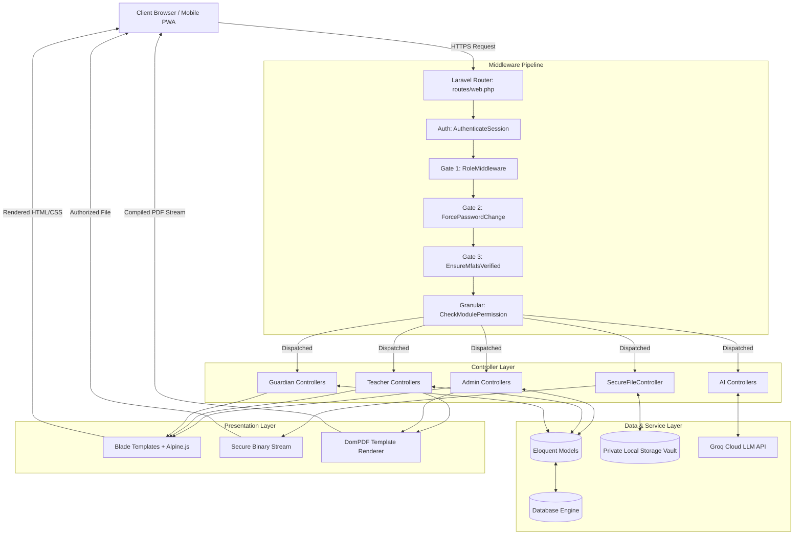
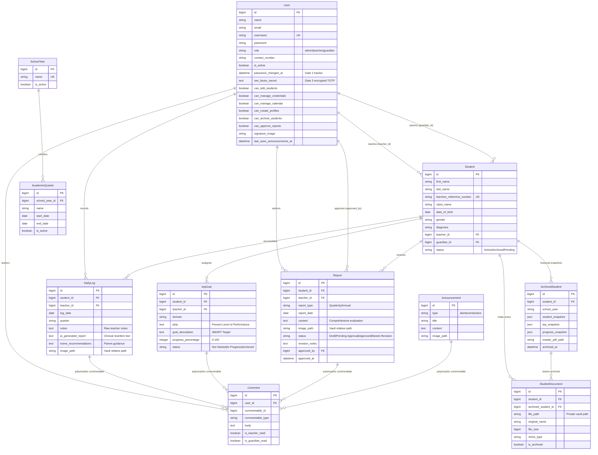
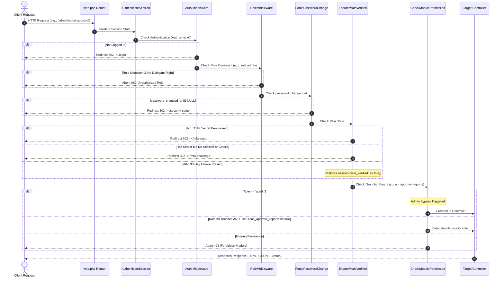

# Dream Achievers Learning Center (DALC) System Documentation

**Authoritative Technical & Architectural Specification**  
*Covers Architecture, Security, Design System, and AI Agent Implementation*

---

## Table of Contents

1. [System Overview](#1-system-overview)
   - [1.1 Purpose & Mission](#11-purpose--mission)
   - [1.2 Target User Roles](#12-target-user-roles)
   - [1.3 Core Functional Modules](#13-core-functional-modules)
2. [ARCHITECTURE](#2-architecture)
   - [2.1 Technology Stack & System Requirements](#21-technology-stack--system-requirements)
   - [2.2 Directory Architecture](#22-directory-architecture)
   - [2.3 MVC Architectural Breakdown](#23-mvc-architectural-breakdown)
   - [2.4 Database Architecture & Entity Relationship Diagram (ERD)](#24-database-architecture--entity-relationship-diagram-erd)
   - [2.5 Route Architecture & Endpoint Catalog](#25-route-architecture--endpoint-catalog)
   - [2.6 Middleware Pipeline & Request Lifecycle](#26-middleware-pipeline--request-lifecycle)
3. [SECURITY](#3-security)
   - [3.1 3-Gate Authentication Architecture](#31-3-gate-authentication-architecture)
   - [3.2 Two-Factor Authentication (TOTP / Google Authenticator)](#32-two-factor-authentication-totp--google-authenticator)
   - [3.3 Role-Based Access Control (RBAC) System](#33-role-based-access-control-rbac-system)
   - [3.4 Granular Module Permission Matrix](#34-granular-module-permission-matrix)
   - [3.5 Secure File Vault (`SecureFileController`)](#35-secure-file-vault-securefilecontroller)
   - [3.6 Data Protection, Encryption & Cryptographic Standards](#36-data-protection-encryption--cryptographic-standards)
   - [3.7 Session & Cookie Security](#37-session--cookie-security)
4. [DESIGN SYSTEM](#4-design-system)
   - [4.1 Brand Identity & Color Palette Tokens](#41-brand-identity--color-palette-tokens)
   - [4.2 Typography & Hierarchy](#42-typography--hierarchy)
   - [4.3 Blade Component Library & UI Patterns](#43-blade-component-library--ui-patterns)
   - [4.4 Layout Architecture & Navigation Systems](#44-layout-architecture--navigation-systems)
   - [4.5 Mobile-First & Touch-Optimized UX Standards](#45-mobile-first--touch-optimized-ux-standards)
   - [4.6 Iconography & Visual Feedback](#46-iconography--visual-feedback)
5. [AI AGENT SYSTEM](#5-ai-agent-system)
   - [5.1 Architecture & Groq Cloud Proxy Pattern](#51-architecture--groq-cloud-proxy-pattern)
   - [5.2 Model Selection & Configuration](#52-model-selection--configuration)
   - [5.3 Core AI Capabilities](#53-core-ai-capabilities)
     - [5.3.1 Daily Observation Log Rewriting](#531-daily-observation-log-rewriting)
     - [5.3.2 IEP SMART Goal & Objective Generation](#532-iep-smart-goal--objective-generation)
     - [5.3.3 Comprehensive Progress Report Generation](#533-comprehensive-progress-report-generation)
     - [5.3.4 Home Learning & Behavioral Recommendations](#534-home-learning--behavioral-recommendations)
   - [5.4 Prompt Engineering Patterns & Guardrails](#54-prompt-engineering-patterns--guardrails)
   - [5.5 Error Handling, Fallbacks & Operational Boundaries](#55-error-handling-fallbacks--operational-boundaries)
6. [Operations & Maintenance](#6-operations--maintenance)
   - [6.1 Environment Configuration](#61-environment-configuration)
   - [6.2 Key Artisan Commands & Workflows](#62-key-artisan-commands--workflows)

---

## 1. System Overview

### 1.1 Purpose & Mission
The **Dream Achievers Learning Center (DALC) System** is a unified, specialized enterprise web application engineered specifically for **Special Education (SPED)** administration, individualized student development tracking, and secure home-school collaboration. 

Special Education environments require meticulous documentation, strict confidentiality compliance, and continuous communication between educators, administrators, and guardians. DALC eliminates paper-heavy tracking by consolidating **Daily Observation Logs**, **Individualized Education Programs (IEP)**, **Quarterly/Annual Progress Reports**, **Medical & Educational Document Vaults**, and **Yearly Academic Archival** into a single secure platform.

### 1.2 Target User Roles
The system operates across three distinct user roles, each with designated workflows and interfaces:

| Role | Primary Functions | Key Workflows |
|---|---|---|
| **Admin (`admin`)** | Institutional oversight, compliance, governance, academic calendar, security auditing, and user lifecycle management. | Manage user accounts & granular permissions, configure School Years & Quarters, approve/reject student reports, trigger annual student archive & rollover, broadcast system announcements. |
| **Teacher (`teacher`)** | Pedagogical management, daily documentation, IEP goal authoring, progress reporting, and parent communication. | Record daily observational logs with photo evidence, author and track SMART IEP goals, generate AI-assisted clinical reports, upload student files, interact with parents via polymorphic comment threads. |
| **Guardian (`guardian`)** | Student tracking, transparency, home reinforcement, and communication with teachers. | View child's real-time daily logs, monitor IEP milestones, review quarterly progress reports, download formal IEP/Report PDFs, access AI-recommended home activities, participate in threaded discussions. |

### 1.3 Core Functional Modules
- **Student Profile Management**: Complete demographic, developmental diagnosis, class assignments, and learner reference number (LRN) tracking.
- **Daily Observation Logs**: Real-time logging of classroom behavior, social interactions, academic progress, sensory reactions, and visual evidence.
- **IEP Goal Tracking**: Domain-based SMART goal creation with Present Levels of Performance (PLOP) baselines and milestone percentage progress bars.
- **Clinical Progress Reports**: Quarterly and annual evaluation reports subject to administrative review and cryptographic signature rendering.
- **Academic Calendar Engine**: Multi-year academic calendar management with automatic date-based quarter synchronization.
- **Secure Document Vault**: Private, non-public file storage for sensitive diagnostic records, psychological assessments, and photo evidence.
- **Yearly Archival & Rollover Engine**: Annual student record freeze, immutable snapshot creation, multi-document compilation, and master PDF generation.
- **Real-Time Notification & Commenting**: Polymorphic discussion system allowing contextual dialogues on logs, goals, reports, and announcements.
- **AI Assistive Agent**: Groq-powered generative intelligence tailored for special education clinical phrasing, SMART IEP goal drafting, and personalized home activity plans.

---

## 2. ARCHITECTURE

### 2.1 Technology Stack & System Requirements

#### Core Backend & Infrastructure
- **Framework**: Laravel 12.x (PHP 8.2+)
- **Architecture Pattern**: Model-View-Controller (MVC) with Service-Layer / Controller Delegations
- **Database**: SQLite (Development / Testing) / MySQL or PostgreSQL (Production Capable)
- **Session Driver**: Database / File-based session management with cookie binding
- **PDF Engine**: DomPDF via `barryvdh/laravel-dompdf` (PDF compilation and streaming)
- **Image Processing**: `intervention/image` for signature and media processing
- **Authentication**: Laravel Breeze baseline extended with custom Multi-Factor Authentication & Force-Password policies
- **Authorization**: Spatie Laravel-Permission (`spatie/laravel-permission`) augmented with custom role & granular permission middleware

#### Frontend & UI Stack
- **Templating**: Laravel Blade with component abstractions
- **Styling**: Tailwind CSS (CDN-driven with customized brand palettes)
- **Reactivity & Micro-Interactions**: Alpine.js 3.x (Declarative component state, dropdowns, modals, notification drawers)
- **Typography**: Google Fonts (`Nunito` for primary UI; `Inter` for document text)
- **Iconography**: Font Awesome 6.5.0 Free Solid / Regular
- **Asset Bundler**: Vite (optional local tooling; asset pipeline optimized for low-latency delivery)

#### External Services & Integrations
- **AI Inference Engine**: Groq Cloud API (`openai/gpt-oss-20b` high-throughput model)
- **MFA / TOTP**: Google2FA (`pragmarx/google2fa`) paired with `bacon/bacon-qr-code` for SVG QR generation

---

### 2.2 Directory Architecture

```
dalc-system/
├── app/
│   ├── Http/
│   │   ├── Controllers/
│   │   │   ├── Admin/
│   │   │   │   ├── AcademicQuarterController.php   # Academic calendar & quarter sync
│   │   │   │   ├── AccountController.php           # User credentials & granular rights
│   │   │   │   ├── AdminController.php             # Admin dashboard & analytics
│   │   │   │   ├── AdminStudentController.php      # Student enrollment & re-enrollment
│   │   │   │   ├── AnnouncementController.php      # Broadcast management
│   │   │   │   ├── ArchiveController.php           # Annual snapshot & rollover engine
│   │   │   │   └── ReportApprovalController.php    # Report review workflow
│   │   │   ├── Auth/
│   │   │   │   ├── AuthenticatedSessionController.php
│   │   │   │   ├── MfaChallengeController.php      # Gate 3: 6-digit TOTP verification
│   │   │   │   ├── MfaSetupController.php          # Gate 3: Initial QR code provisioning
│   │   │   │   ├── NewPasswordController.php
│   │   │   │   ├── PasswordResetLinkController.php
│   │   │   │   └── PasswordSetupController.php     # Gate 2: First-login password force
│   │   │   ├── Guardian/
│   │   │   │   └── GuardianController.php          # Guardian portal & multi-child switch
│   │   │   ├── Teacher/
│   │   │   │   ├── DailyLogController.php          # Observational logs & AI actions
│   │   │   │   ├── FileController.php              # Teacher media handling
│   │   │   │   ├── IepGoalController.php           # IEP tracking & AI goal generation
│   │   │   │   ├── ReportController.php            # Clinical reporting & AI generation
│   │   │   │   ├── TeacherController.php           # Teacher dashboard
│   │   │   │   └── TeacherStudentController.php    # Teacher-assigned student roster
│   │   │   ├── AiAssistantController.php           # Global AI proxy controller
│   │   │   ├── CommentController.php               # Polymorphic comment threads
│   │   │   ├── HomeController.php                  # Landing & role-dispatch entry point
│   │   │   ├── ProfileController.php               # Account settings & signature upload
│   │   │   └── SecureFileController.php            # Authorization-guarded file vault
│   │   └── Middleware/
│   │       ├── CheckModulePermission.php           # Granular sub-admin permission gate
│   │       ├── EnsureMfaIsVerified.php             # Gate 3: TOTP & 30-day cookie validator
│   │       ├── ForcePasswordChange.php             # Gate 2: Null timestamp enforcement
│   │       └── RoleMiddleware.php                  # Primary RBAC route barrier
│   ├── Models/
│   │   ├── AcademicQuarter.php                     # School terms & date synchronization
│   │   ├── Announcement.php                        # School-wide broadcast items
│   │   ├── ArchivedStudent.php                     # Immutable historical snapshots
│   │   ├── Comment.php                             # Polymorphic discussion records
│   │   ├── DailyLog.php                            # Classroom observation entries
│   │   ├── IepGoal.php                             # Individualized goals & PLOP
│   │   ├── Report.php                              # Quarterly/Annual narrative reports
│   │   ├── SchoolYear.php                          # Academic calendar anchor
│   │   ├── Student.php                             # Active student core record
│   │   ├── StudentDocument.php                     # Vaulted medical/academic files
│   │   └── User.php                                # Core identity, credentials & roles
│   └── Notifications/
│       ├── ResetPasswordNotification.php           # Password reset mailer
│       └── SystemAlert.php                         # In-app real-time notification alerts
├── bootstrap/
│   └── app.php                                     # Middleware registration & proxy config
├── config/
│   ├── auth.php                                    # User providers & password brokers
│   ├── filesystems.php                             # Local private vault vs public disks
│   └── services.php                                # Groq AI credentials & service configs
├── database/
│   ├── migrations/                                 # Schema migrations
│   └── seeders/                                    # Initial roles & default admin accounts
├── docs/
│   └── SYSTEM_DOCUMENTATION.md                     # System documentation reference
├── resources/
│   ├── views/
│   │   ├── admin/                                  # Admin portal Blade templates
│   │   ├── auth/                                   # Authentication & MFA view components
│   │   ├── components/                             # Reusable UI Blade components
│   │   ├── guardian/                               # Guardian portal Blade templates
│   │   ├── layouts/
│   │   │   └── app.blade.php                       # Master application shell & navigation
│   │   ├── pdf/                                    # DomPDF export templates
│   │   └── teacher/                                # Teacher portal Blade templates
└── routes/
    ├── auth.php                                    # Authentication routes
    ├── console.php                                 # Artisan scheduled task hooks
    └── web.php                                     # Application route definitions
```

---

### 2.3 MVC Architectural Breakdown

The DALC system strictly adheres to the Model-View-Controller design pattern, supplemented by authorization middleware:



---

### 2.4 Database Architecture & Entity Relationship Diagram (ERD)

The relational architecture supports multi-role access, polymorphic discussions, hierarchical academic calendars, and immutable historical archives:



---

### 2.5 Route Architecture & Endpoint Catalog

The route system in `routes/web.php` is strictly segmented into four tiers: **Public/Root**, **Shared Authenticated**, **Role-Isolated Portals**, and **Granular Permission Modules**.

#### 1. Public & Global Authentication
| Method | URI | Controller Action | Name | Security Scope |
|---|---|---|---|---|
| `GET` | `/` | `HomeController@index` | `home` | Public landing / Smart role redirect |
| `GET` | `/login` | `AuthenticatedSessionController@create` | `login` | Guest only |
| `POST` | `/login` | `AuthenticatedSessionController@store` | `login.store` | Rate-limited login verification |
| `POST` | `/logout` | `AuthenticatedSessionController@destroy` | `logout` | Authenticated session destruction |

#### 2. Authentication Gates & Security Setup
| Method | URI | Controller Action | Name | Security Scope |
|---|---|---|---|---|
| `GET` | `/security-setup` | `PasswordSetupController@index` | `security.setup` | Gate 2: Forced Password Setup |
| `POST` | `/security-setup` | `PasswordSetupController@store` | `security.setup.store` | Gate 2: Commit New Password |
| `GET` | `/mfa-setup` | `MfaSetupController@index` | `security.mfa.setup` | Gate 3: Provision TOTP Secret & QR |
| `POST` | `/mfa-setup` | `MfaSetupController@verify` | `security.mfa.verify` | Gate 3: Confirm Initial TOTP Code |
| `GET` | `/mfa-challenge` | `MfaChallengeController@index` | `security.mfa.challenge` | Gate 3: Prompt 6-digit TOTP Code |
| `POST` | `/mfa-challenge` | `MfaChallengeController@verify` | `security.mfa.verify-login` | Gate 3: Validate Code + Set 30d Cookie |

#### 3. Shared Secure Vault & Cross-Role Endpoints
| Method | URI | Controller Action | Name | Purpose |
|---|---|---|---|---|
| `GET` | `/profile` | `ProfileController@index` | `profile.index` | View/Edit profile & upload signature |
| `POST` | `/comments` | `CommentController@store` | `comments.store` | Post discussion reply |
| `PUT` | `/comments/{id}` | `CommentController@update` | `comments.update` | Edit discussion comment |
| `DELETE` | `/comments/{id}` | `CommentController@destroy` | `comments.destroy` | Delete discussion comment |
| `GET` | `/secure-log-photo/{id}` | `SecureFileController@show` | `secure.log-photo` | Vault: Daily log photo |
| `GET` | `/secure-report-photo/{id}` | `SecureFileController@reportPhoto` | `secure.report-photo` | Vault: Report media |
| `GET` | `/secure-medical-document/{id}` | `SecureFileController@medicalDocument` | `secure.student-medical` | Vault: Student medical records |
| `GET` | `/secure-document/{id}` | `SecureFileController@document` | `secure.student-document` | Vault: General student documents |
| `POST` | `/ai/rewrite-log` | `AiAssistantController@rewriteDailyLog` | `ai.rewrite` | Global AI observation rewriting |

#### 4. Strictly Admin Routes (`role:admin` + Gates 2 & 3)
| Method | URI | Controller Action | Name |
|---|---|---|---|
| `GET` | `/admin/dashboard` | `AdminController@dashboard` | `admin.dashboard` |
| `GET` | `/admin/announcements` | `AnnouncementController@index` | `admin.announcements.index` |
| `GET` | `/admin/announcements/create` | `AnnouncementController@create` | `admin.announcements.create` |
| `POST` | `/admin/announcements` | `AnnouncementController@store` | `admin.announcements.store` |
| `GET` | `/admin/announcements/{id}/edit` | `AnnouncementController@edit` | `admin.announcements.edit` |
| `PUT` | `/admin/announcements/{id}` | `AnnouncementController@update` | `admin.announcements.update` |
| `DELETE` | `/admin/announcements/{id}` | `AnnouncementController@destroy` | `admin.announcements.destroy` |

#### 5. Admin & Granular Delegated Teacher Routes (Gates 2 & 3 + `CheckModulePermission`)
| Method | URI | Controller Action | Permission Flag Required |
|---|---|---|---|
| `GET` | `/admin/report-approval` | `ReportApprovalController@index` | `can_approve_reports` |
| `POST` | `/admin/report-approval/{id}/status` | `ReportApprovalController@updateStatus` | `can_approve_reports` |
| `RESOURCE` | `/admin/students` | `AdminStudentController` | `can_create_profiles` |
| `POST` | `/admin/students/{id}/re-enroll` | `AdminStudentController@reEnroll` | `can_create_profiles` |
| `GET` | `/admin/archive` | `ArchiveController@index` | `can_archive_students` |
| `POST` | `/admin/archive/run` | `ArchiveController@runArchive` | `can_archive_students` |
| `GET` | `/admin/archive/{id}/pdf` | `ArchiveController@masterPdf` | `can_archive_students` |
| `GET` | `/admin/academic-quarters` | `AcademicQuarterController@index` | `can_manage_calendar` |
| `POST` | `/admin/academic-quarters/{id?}` | `AcademicQuarterController@updateAll` | `can_manage_calendar` |
| `PATCH` | `/admin/school-years/{id}/set-active` | `AcademicQuarterController@setActive` | `can_manage_calendar` |
| `RESOURCE` | `/admin/accounts` | `AccountController` | `can_manage_credentials` |
| `PATCH` | `/admin/accounts/{id}/permissions` | `AccountController@updatePermissions` | `can_manage_credentials` |

#### 6. Teacher Portal (`role:teacher` + Gates 2 & 3)
| Method | URI | Controller Action | Name |
|---|---|---|---|
| `GET` | `/teacher/dashboard` | `TeacherController@dashboard` | `teacher.dashboard` |
| `GET` | `/teacher/daily-logs` | `DailyLogController@index` | `teacher.daily-logs.index` |
| `POST` | `/teacher/daily-logs` | `DailyLogController@store` | `teacher.daily-logs.store` |
| `POST` | `/teacher/daily-logs/generate-ai` | `DailyLogController@generateAiReport` | `teacher.daily-logs.generate-ai` |
| `POST` | `/teacher/daily-logs/generate-recommendations` | `DailyLogController@generateAiRecommendations` | `teacher.daily-logs.generate-recommendations` |
| `GET` | `/teacher/daily-logs/{id}/pdf` | `DailyLogController@downloadPdf` | `teacher.daily-logs.pdf` |
| `RESOURCE` | `/teacher/iep-goals` | `IepGoalController` | `teacher.iep-goals.*` |
| `POST` | `/teacher/iep-goals/generate-ai` | `IepGoalController@generateAi` | `teacher.iep-goals.generate-ai` |
| `GET` | `/teacher/students/{student}/iep-pdf` | `IepGoalController@downloadIepPdf` | `teacher.iep-goals.pdf` |
| `RESOURCE` | `/teacher/reports` | `ReportController` | `teacher.reports.*` |
| `POST` | `/teacher/reports/generate-ai` | `ReportController@generateAiReport` | `teacher.reports.generate-ai` |
| `GET` | `/teacher/reports/{id}/pdf` | `ReportController@downloadPdf` | `teacher.reports.pdf` |

#### 7. Guardian Portal (`role:guardian` + Gates 2 & 3)
| Method | URI | Controller Action | Name |
|---|---|---|---|
| `GET` | `/guardian/dashboard` | `GuardianController@dashboard` | `guardian.dashboard` |
| `GET` | `/guardian/goals` | `GuardianController@goals` | `guardian.goals` |
| `GET` | `/guardian/goals/download-iep/{id}` | `GuardianController@downloadIepPdf` | `guardian.goals.download-iep` |
| `GET` | `/guardian/reports` | `GuardianController@reports` | `guardian.reports` |
| `GET` | `/guardian/reports/{id}/pdf` | `GuardianController@downloadReportPdf` | `guardian.reports.pdf` |
| `GET` | `/guardian/recommendations` | `GuardianController@recommendations` | `guardian.recommendations` |
| `GET` | `/guardian/logs/archive` | `GuardianController@logsArchive` | `guardian.logs.archive` |
| `GET` | `/guardian/switch-child/{id}` | `GuardianController@switchChild` | `guardian.switch-child` |

---

### 2.6 Middleware Pipeline & Request Lifecycle

Every HTTP request traverses an orchestrated sequence of gates before accessing application controllers:



---

## 3. SECURITY

### 3.1 3-Gate Authentication Architecture

DALC implements an uncompromising **Three-Gate Security Perimeter** ensuring that compromised default credentials or stolen passwords cannot penetrate the system.

```mermaid
graph TD
    Start[User Submits Login] --> Gate1{Gate 1: Primary Credentials}
    Gate1 -- Invalid --> Fail1[422 / Rate-Limited Throttle]
    Gate1 -- Valid --> Gate2{Gate 2: Password Changed?}
    
    Gate2 -- password_changed_at is NULL --> ForceSetup[Redirect to /security-setup<br/>Must enter private password]
    ForceSetup --> SetPass[Update password & set password_changed_at]
    SetPass --> Gate3
    
    Gate2 -- password_changed_at is NOT NULL --> Gate3{Gate 3: MFA Status}
    
    Gate3 -- two_factor_secret is NULL --> SetupMFA[Redirect to /mfa-setup<br/>Scan QR code & confirm TOTP]
    SetupMFA --> SaveSecret[Encrypt secret & store in DB]
    SaveSecret --> VerifyChallenge
    
    Gate3 -- two_factor_secret exists --> CheckDevice{Device Remembered?}
    CheckDevice -- 30-Day Cookie OR Session Active --> Allow[Full System Access Granted]
    CheckDevice -- Unrecognized Device --> VerifyChallenge[Redirect to /mfa-challenge<br/>Enter 6-digit TOTP]
    VerifyChallenge -- Correct Code --> RememberOption{User Checked Remember?}
    RememberOption -- Yes --> SetCookie[Set 30-Day Secure Cookie<br/>mfa_remember_{user_id}]
    RememberOption -- No --> SetSession[Set Session mfa_verified = true]
    SetCookie --> Allow
    SetSession --> Allow
```

#### Gate 1: Primary Credential Validation
- Authenticates against either `username` or `email` using bcrypt password verification.
- Enforces IP-based rate limiting via Laravel Breeze's default throttling to neutralize brute-force attacks.

#### Gate 2: First-Login Password Enforcement (`ForcePasswordChange`)
- Any account created by an administrator receives a temporary password, leaving `password_changed_at` as `NULL`.
- The `ForcePasswordChange` middleware intercepts all incoming requests (except `/security-setup`, its POST handler, and `/logout`).
- The user is held in quarantine until they supply a new password adhering to strict complexity requirements:
  - Minimum 8 characters.
  - At least one uppercase letter and one lowercase letter.
  - At least one numeric digit and one special character symbol.
- Upon successful update, `password_changed_at` is set to the current timestamp.

#### Gate 3: Two-Factor Authentication (`EnsureMfaIsVerified`)
- No user can view confidential student data without active multi-factor protection.
- If `two_factor_secret` is `NULL`, the middleware routes the user to `/mfa-setup`.
- If configured, the middleware requires a 6-digit Time-Based One-Time Password (TOTP).

---

### 3.2 Two-Factor Authentication (TOTP / Google Authenticator)

The 2FA subsystem is powered by `pragmarx/google2fa` and `bacon/bacon-qr-code`, eliminating SMS vulnerabilities in favor of standard RFC 6238 TOTP algorithms.

#### Provisioning Workflow (`/mfa-setup`)
1. Generates an RFC-compliant 16-character base32 secret.
2. Compiles an `otpauth://totp/...` URI embedding the application issuer (`Dream Achievers Learning Center`) and the user's account name.
3. Renders a direct SVG QR code via `BaconQrCode\Renderer\Image\SvgImageBackEnd` (no external third-party API dependencies).
4. The user scans the code into Google Authenticator, Microsoft Authenticator, or 1Password.
5. Verification requires submitting a valid 6-digit token before the secret is saved to the database.

#### Dual Verification & 30-Day Remember Device Security
- **Session Layer**: Once verified, the session flag `mfa_verified = true` is stored in the user's active session.
- **Persistent Device Layer**: Users can check *"Remember this device for 30 days"*.
  - Generates a scoped, encrypted cookie named `mfa_remember_{user_id}`.
  - Value is set to `hash_hmac('sha256', $user->id . $user->password, config('app.key'))`.
  - Stored with `HttpOnly`, `Secure` (in production), and `SameSite=Lax` flags.
- **Automatic Invalidation**: If the user's password changes, the hash HMAC dynamically breaks, instantly revoking all remembered devices across all browsers.

---

### 3.3 Role-Based Access Control (RBAC) System

DALC employs a role-isolation model preventing privilege escalation across boundaries:

```
[Incoming Request]
       │
       ▼
[RoleMiddleware: $role]
       ├─────────────────┬─────────────────┐
       ▼                 ▼                 ▼
 role === 'admin'   role === 'teacher'  role === 'guardian'
       │                 │                 │
       ▼                 ▼                 ▼
 /admin/* Routes   /teacher/* Routes   /guardian/* Routes
```

- Roles are enforced via the `RoleMiddleware` class: `Route::middleware(['auth', 'role:admin'])`.
- If an unauthorized user accesses another role's endpoint, the system terminates execution with an `HTTP 403 Forbidden` response.
- Integrated with Spatie Permission (`spatie/laravel-permission`) on the `User` model (`HasRoles` trait) for role assignments.

---

### 3.4 Granular Module Permission Matrix

To support delegation without promoting teachers to full Super Admins, DALC provides **6 Granular Module Permission Switches** stored as boolean columns on the `users` table:

```mermaid
graph LR
    subgraph Granular Switches
        P1[can_edit_students]
        P2[can_manage_credentials]
        P3[can_manage_calendar]
        P4[can_create_profiles]
        P5[can_archive_students]
        P6[can_approve_reports]
    end

    subgraph Protected Modules
        P1 -->|Teacher Edit Student Info| M1[/admin/accounts/{id}/toggle-edit]
        P2 -->|User & Password Management| M2[/admin/accounts/*]
        P3 -->|School Years & Quarters| M3[/admin/academic-quarters/*]
        P4 -->|Student Enrollment & Docs| M4[/admin/students/*]
        P5 -->|Annual Archive & Rollover| M5[/admin/archive/*]
        P6 -->|Clinical Report Approvals| M6[/admin/report-approval/*]
    end

    Admin[Master Admin] -.->|Bypasses All Checks| M1 & M2 & M3 & M4 & M5 & M6
```

#### Enforcement Implementation (`CheckModulePermission.php`)
```php
public function handle(Request $request, Closure $next, $permission): Response
{
    $user = auth()->user();

    // 1. Super Admins bypass all checks
    if ($user->role === 'admin') {
        return $next($request);
    }

    // 2. Teachers must have the designated switch flipped to TRUE
    if ($user->role === 'teacher' && $user->$permission) {
        return $next($request);
    }

    // 3. Block unauthorized access
    abort(403, 'Unauthorized. You do not have permission to access this module.');
}
```

---

### 3.5 Secure File Vault (`SecureFileController`)

Confidential medical history, psychological assessments, student photos, and developmental reports are **strictly prohibited from the public web root** (`public/storage`). All sensitive files reside on the private `local` storage disk (`storage/app/private/` or `storage/app/`).

```mermaid
flowchart TD
    Req[Client Requests File:<br/>/secure-document/{id}] --> Ctl[SecureFileController]
    Ctl --> AuthCheck{Is User Logged In?}
    AuthCheck -- No --> Deny[403 / Redirect]
    AuthCheck -- Yes --> RoleCheck{Inspect User Role}
    
    RoleCheck -- Admin --> Grant[Authorized: Super Admin]
    RoleCheck -- Teacher --> TeachCheck{teacher_id == user.id?}
    RoleCheck -- Guardian --> GuardCheck{guardian_id == user.id?}
    
    TeachCheck -- Yes --> Grant
    TeachCheck -- No --> Violate[Abort 403: Security Violation]
    
    GuardCheck -- Yes --> Grant
    GuardCheck -- No --> Violate
    
    Grant --> DiskCheck{Check Storage::disk('local')}
    DiskCheck -- Found --> Stream[Stream Binary with MIME Headers]
    DiskCheck -- Not in Local --> FallbackCheck{Check Storage::disk('public')}
    FallbackCheck -- Found --> Stream
    FallbackCheck -- Missing --> NotFound[Abort 404: File Not Found]
```

#### Secure Vault Authorization Rules
| Endpoint | Model | Access Rule |
|---|---|---|
| `/secure-log-photo/{id}` | `DailyLog` | `admin` OR `teacher_id == user.id` OR `guardian_id == user.id` |
| `/secure-report-photo/{id}` | `Report` | `admin` OR `teacher_id == user.id` OR `guardian_id == user.id` |
| `/secure-medical-document/{id}` | `Student` | `admin` OR `teacher_id == user.id` OR `guardian_id == user.id` |
| `/secure-document/{id}` | `StudentDocument` | `admin` OR `teacher_id == user.id` OR `guardian_id == user.id` |

#### Stream Protection
- Serves files using `Storage::disk('local')->response($path, $name)` which sets appropriate `Content-Type` headers and prevents directory traversal attacks.
- Backward compatibility: Seamlessly checks legacy `public` storage if a file predates the vault migration, streaming it through the same authorized proxy controller.

---

### 3.6 Data Protection, Encryption & Cryptographic Standards

- **Encrypted 2FA Secrets**: The `two_factor_secret` field on `User` is protected by Laravel's `'encrypted'` Eloquent cast, encrypting secrets at rest using AES-256-CBC via the application's `APP_KEY`.
- **Password Storage**: Uses the `'hashed'` cast, utilizing PHP's native `password_hash()` with Bcrypt (work factor 12).
- **CSRF Defense**: All state-changing HTTP verbs (`POST`, `PUT`, `PATCH`, `DELETE`) require verified `@csrf` tokens.
- **SQL Injection Prevention**: All queries use Eloquent ORM or parameterized PDO bindings; raw SQL concatenation is prohibited.
- **Input Sanitization & Validation**: Form inputs undergo strict validation rules (MIME types, file size limits, integer boundaries).

---

### 3.7 Session & Cookie Security

- **Session Hijacking Mitigation**: Configured with `\Illuminate\Session\Middleware\AuthenticateSession::class` in the global web middleware stack, terminating sessions across all devices if a user changes their password.
- **Cookie Security Parameters**:
  - `HttpOnly`: Set to `true` on all authentication and 2FA cookies, preventing access from client-side JavaScript (mitigating XSS theft).
  - `SameSite`: Configured to `Lax` to prevent Cross-Site Request Forgery via third-party navigation.
  - `Secure`: Transmitted exclusively over HTTPS in staging and production environments.

---

## 4. DESIGN SYSTEM

### 4.1 Brand Identity & Color Palette Tokens

The DALC user interface follows an authoritative, warm academic aesthetic balancing professional clinical dignity with an inviting learning atmosphere.

```
┌────────────────────────────────────────────────────────────────────────┐
│                        PRIMARY BRAND IDENTITY                          │
├───────────────────┬───────────────────┬────────────────────────────────┤
│ Deep Navy         │ Darker Navy       │ Academic Gold                  │
│ #1E2657           │ #12163A           │ #C4922E                        │
│ Primary Headers,  │ Header Gradients, │ Primary Badges, Accents,       │
│ Buttons, Nav Bars │ Brand Elements    │ Stars & Attention Highlights   │
└───────────────────┴───────────────────┴────────────────────────────────┘

┌────────────────────────────────────────────────────────────────────────┐
│                         WARM CANVAS GRADIENT                           │
├───────────────────┬───────────────────┬────────────────────────────────┤
│ Light Cream       │ Soft Blue Mist    │ Light Cream                    │
│ #F4F1EA           │ #EDF0F8           │ #F4F1EA                        │
│ from-[#F4F1EA]    │ via-[#EDF0F8]     │ to-[#F4F1EA] (bg-fixed)        │
└───────────────────┴───────────────────┴────────────────────────────────┘

┌────────────────────────────────────────────────────────────────────────┐
│                      FUNCTIONAL & STATUS PALETTE                       │
├──────────────┬──────────────┬──────────────┬─────────────┬─────────────┤
│ Blue         │ Emerald      │ Purple       │ Amber       │ Rose        │
│ #3B82F6      │ #10B981      │ #8B5CF6      │ #F59E0B     │ #F43F5E     │
│ Info / Active│ Success / Log│ IEP / Target │ Alert / Warn│ Danger / Del│
└──────────────┴──────────────┴──────────────┴─────────────┴─────────────┘
```

#### Typography Scale & Fonts
- **Primary Body & UI**: `'Nunito', sans-serif` (Weights: 400, 500, 600, 700, 800, 900)
- **Secondary Content & Reports**: `'Inter', sans-serif` (Weights: 400, 500, 600, 700)
- **Neutral Text Hierarchy**:
  - Headings / Strong: `#2C2F45`
  - Body / Subheadings: `#4B5563` (Gray 600)
  - Muted Captions: `#6B7086`
  - Subtle / Dividers: `#9CA0AF` / `#E5E7EB`

---

### 4.2 Blade Component Library & UI Patterns

The application encapsulates repetitive UI patterns into reusable Blade components (`resources/views/components/`):

#### 1. Action Buttons
- **Primary Action**:
  ```html
  <button class="px-4 py-2 bg-[#1E2657] hover:bg-[#12163A] text-white font-bold rounded-xl shadow-md hover:shadow-lg transition-all duration-200 active:scale-95 touch-press">
      Label
  </button>
  ```
- **Accent / Gold Action**:
  ```html
  <button class="px-4 py-2 bg-[#C4922E] hover:bg-[#b08124] text-white font-bold rounded-xl shadow-md transition-all active:scale-95">
      Highlight Action
  </button>
  ```
- **Secondary / Ghost**:
  ```html
  <button class="px-4 py-2 bg-white/80 border border-[#1E2657]/20 text-[#1E2657] font-semibold rounded-xl hover:bg-white transition-all">
      Cancel
  </button>
  ```
- **Danger Action**:
  ```html
  <button class="px-4 py-2 bg-rose-600 hover:bg-rose-700 text-white font-bold rounded-xl shadow-sm transition-all active:scale-95">
      Delete
  </button>
  ```

#### 2. Glassmorphic Surface Cards
```html
<div class="bg-white/85 backdrop-blur-md border border-[#1E2657]/10 rounded-2xl p-5 sm:p-6 shadow-sm hover:shadow-md transition-all">
    <!-- Card Content -->
</div>
```

#### 3. Polymorphic Comment Thread
- Component: `resources/views/components/comments-thread.blade.php`
- Attachable to any model implementing `morphMany(Comment::class, 'commentable')`:
  - `DailyLog`
  - `IepGoal`
  - `Report`
  - `Announcement`
- Features real-time unread indicators for teachers and guardians, deletion controls for authors, and instant Alpine-based reply toggles.

---

### 4.3 Layout Architecture & Navigation Systems

#### Desktop Architecture
- **Sticky Glass Header**: `sticky top-0 z-50 h-16 bg-white/80 backdrop-blur-lg border-b border-[#1E2657]/20`
- **Dynamic Context Header**: Automatically renders active route titles and returns breadcrumb navigation.
- **Unsaved Changes Guard**: Built-in JavaScript listener detects dirty forms or AI drafts, preventing accidental navigation:
  ```javascript
  if (window.hasUnsavedAiChanges && !confirm("You have unsaved changes. Are you sure you want to leave?")) {
      e.preventDefault();
  }
  ```

#### Role-Aware Bottom Navigation Bar (Mobile)
A persistent 5-tab mobile navigation bar renders on viewport widths `< 768px`, custom-tailored per role:

```
┌────────────────────────────────────────────────────────────────────────┐
│                        ROLE BOTTOM NAVIGATION                          │
├───────────────┬────────────────────────────────────────────────────────┤
│ Teacher Tabs  │ [1] Home  [2] Logging  [3] IEP  [4] Reports  [5] Students│
├───────────────┼────────────────────────────────────────────────────────┤
│ Admin Tabs    │ [1] Home  [2] Students [3] Accounts [4] Approvals [5] Alerts│
├───────────────┼────────────────────────────────────────────────────────┤
│ Guardian Tabs │ [1] Home  [2] Goals    [3] Advice   [4] Reports   [5] Alerts│
└───────────────┴────────────────────────────────────────────────────────┘
```

---

### 4.4 Mobile-First & Touch-Optimized UX Standards

- **Viewport Configuration**:
  `<meta name="viewport" content="width=device-width, initial-scale=1.0, maximum-scale=5.0, viewport-fit=cover">`
- **iOS Safari 16px Font Rule**:
  Enforces `font-size: 16px !important;` on all form inputs and select dropdowns on viewports under 640px, preventing iOS Safari from triggering disruptive automatic zooming.
- **Touch-Press Micro-Interactions**:
  Elements utilize `.touch-press:active { transform: scale(0.97); }` providing immediate physical tactile feedback on mobile touchscreens.
- **Safe Area Insets**:
  Padding offsets (`pb-20` on body) ensure that floating action buttons and mobile bottom bars clear iOS Home Indicators and Android system navigation bars.

---

## 5. AI AGENT SYSTEM

### 5.1 Architecture & Groq Cloud Proxy Pattern

DALC implements a **Secure Server-Side Proxy Architecture** for artificial intelligence. No client browser ever interfaces with the AI provider directly, preventing API key exposure and prompt tampering.

```mermaid
flowchart LR
    Client[Browser / Teacher UI] -->|POST Form Data / Prompts| LaravelProxy[Laravel Controller Proxy]
    
    subgraph Server-Side Isolation
        LaravelProxy --> Guard[Auth & Permission Validation]
        Guard --> Assemble[Context Assembly & Student DB Injection]
        Assemble --> HTTPClient[Http::withHeaders(Bearer Key)]
    end
    
    HTTPClient -->|HTTPS REST| Groq[Groq Cloud API Endpoint]
    Groq -->|Completions Stream / JSON| HTTPClient
    
    subgraph Post-Processing
        HTTPClient --> Clean[Strip Markdown Prefixes & Clean Artifacts]
        Clean --> Validate[JSON Structural Validation]
    end
    
    Validate -->|Clean Payload| Client
```

- **Endpoint**: `https://api.groq.com/openai/v1/chat/completions`
- **Authentication**: Key loaded from server environment (`config('services.groq.api_key')` or `env('GROQ_API_KEY')`).
- **Network Resilience**: 60-second execution timeouts via `Http::timeout(60)` accommodating large context completions.

---

### 5.2 Model Selection & Configuration

- **Model Identifier**: `openai/gpt-oss-20b` (hosted via Groq Cloud)
- **Inference Speed**: ~300-500 tokens/sec, providing instantaneous generation for classroom educators.
- **Tuned Temperature Profiles**:
  - `temperature: 0.5`: Used for clinical progress reports and official document rewriting (ensuring high determinism and objective tone).
  - `temperature: 0.7`: Used for creative IEP goal synthesis and diverse home activity recommendations.

---

### 5.3 Core AI Capabilities

#### 5.3.1 Daily Observation Log Rewriting
- **Route**: `POST /ai/rewrite-log` & `POST /teacher/daily-logs/generate-ai`
- **Controllers**: `AiAssistantController@rewriteDailyLog` / `DailyLogController@generateAiReport`
- **Function**: Takes raw, informal teacher notes (e.g., *"john had a meltdown during math, threw blocks, calmed down with weighted blanket after 10 mins"*) and transforms them into objective, clinical special education documentation suitable for official records and parental viewing.
- **System Directive Prompt Pattern**:
  > *"You are an expert Special Education (SPED) teacher and clinical documenter. Rewrite informal classroom notes into a clear, professional, compassionate, and strengths-focused observation report. Remove emotional bias, maintain clinical accuracy, highlight positive coping mechanisms, and format with clear paragraphing."*

#### 5.3.2 IEP SMART Goal & Objective Generation
- **Route**: `POST /teacher/iep-goals/generate-ai`
- **Controller**: `IepGoalController@generateAi`
- **Function**: Accepts developmental domain (e.g., *Communication*, *Fine Motor*, *Cognitive*, *Social-Emotional*) and the student's Present Level of Performance (PLOP), then generates three measurable SMART objectives and classroom interventions.
- **Output Format**: Strictly enforced JSON structure:
  ```json
  {
    "goal": "Within 36 instructional weeks, given visual communication cues, the student will independently request assistance in 4 out of 5 opportunities across 3 consecutive sessions.",
    "objectives": [
      "Objective 1: Identify and point to the help icon...",
      "Objective 2: Verbally vocalize request...",
      "Objective 3: Generalize skill across classroom settings..."
    ],
    "interventions": [
      "Intervention 1: Visual schedule integration",
      "Intervention 2: Peer modeling during structured activities"
    ]
  }
  ```

#### 5.3.3 Comprehensive Progress Report Generation
- **Route**: `POST /teacher/reports/generate-ai`
- **Controller**: `ReportController@generateAiReport`
- **Function**: Synthesizes months of student data into an official quarterly or annual progress narrative.
- **Context Injection**: Automatically gathers:
  - All **Daily Observation Logs** recorded for the student during the selected quarter.
  - Active **IEP Goals** and their current milestone percentages.
  - Historical progress notes.
- **Narrative Sections Produced**:
  1. *Executive Developmental Summary*
  2. *Academic & Cognitive Milestones*
  3. *Behavioral, Sensory & Social Adaptations*
  4. *IEP Goal Benchmark Analysis*
  5. *Recommendations for Next Academic Term*

#### 5.3.4 Home Learning & Behavioral Recommendations
- **Route**: `POST /teacher/daily-logs/generate-recommendations`
- **Controller**: `DailyLogController@generateAiRecommendations`
- **Function**: Analyzes student daily performance and generates two practical, compassionate, low-stress home reinforcement activities for parents.
- **Tone**: Warm, encouraging, and free of clinical jargon.

---

### 5.4 Prompt Engineering Patterns & Guardrails

1. **System Persona Framing**: Every request embeds the persona of an expert Special Education diagnostician and child advocate.
2. **Contextual Isolation**: Student Personally Identifiable Information (PII) such as LRN and guardian contact details are never sent to the LLM; only the student's first name, age, and relevant clinical observations are injected.
3. **Markdown Artifact Stripping**: Automated post-processing regex filters eliminate unsolicited conversational filler (`"Here is the report:"` or `"Certainly! Here's the goal:"`), delivering clean text directly into input fields.
4. **Human-in-the-Loop Review**: AI outputs are never committed directly to the database. They populate draft textareas in the teacher's UI, requiring educator review, verification, and manual saving.

---

### 5.5 Error Handling, Fallbacks & Operational Boundaries

- **Key Verification**: Controllers verify API key presence before dispatching network requests, returning user-friendly validation notices if unconfigured.
- **Graceful Fallbacks**: If the Groq API returns a rate-limit (`429`) or upstream error (`500`), the controller catches the exception and returns a structured JSON response:
  ```json
  {
    "success": false,
    "message": "AI assistant is temporarily unavailable. You can continue writing manually or try again in a few moments."
  }
  ```
- **Unsaved Changes Warning**: Front-end forms listen for AI population events and activate the unsaved-changes protection to prevent data loss.

---

## 6. Operations & Maintenance

### 6.1 Environment Configuration

Key configuration parameters required in `.env`:

```ini
# Application Configuration
APP_NAME="Dream Achievers Learning Center"
APP_ENV=production
APP_DEBUG=false
APP_URL=https://dalc.example.com

# Database Connection
DB_CONNECTION=sqlite
# DB_DATABASE=/absolute/path/to/database.sqlite

# Session Configuration
SESSION_DRIVER=database
SESSION_LIFETIME=120
SESSION_ENCRYPT=true

# Groq Cloud AI Service
GROQ_API_KEY=gsk_your_groq_production_api_key_here

# Mailer Configuration (for password resets)
MAIL_MAILER=smtp
MAIL_HOST=smtp.mailgun.org
MAIL_PORT=587
MAIL_USERNAME=your_username
MAIL_PASSWORD=your_password
MAIL_ENCRYPTION=tls
MAIL_FROM_ADDRESS="no-reply@dalc.edu.ph"
MAIL_FROM_NAME="${APP_NAME}"
```

### 6.2 Key Artisan Commands & Workflows

#### 1. Setup & Migration
```bash
# Run database migrations
php artisan migrate

# Seed foundational roles and initial master administrator
php artisan db:seed
```

#### 2. Cache & Optimization (Production Deployment)
```bash
# Clear all cached configurations
php artisan optimize:clear

# Compile and cache routes, configuration, and views
php artisan optimize
```

#### 3. Academic Calendar Rollover Engine
The annual rollover can be executed via the Admin interface (`/admin/archive`) or invoked via scheduled jobs during year-end maintenance. This compiles historical logs, IEP goal states, and student documents into permanent JSON snapshots and generates immutable master archive records.

---

*Document Version: 1.0.0*  
*Classification: Confidential — For Dream Achievers Learning Center Internal Operations Only*
